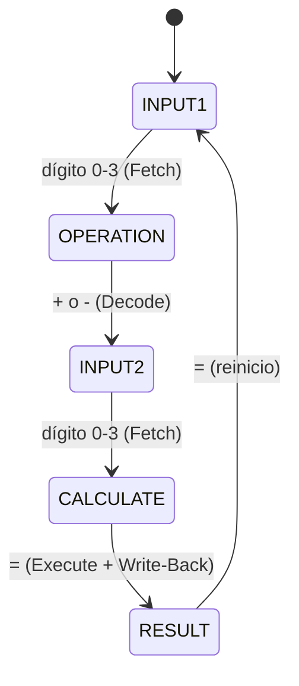
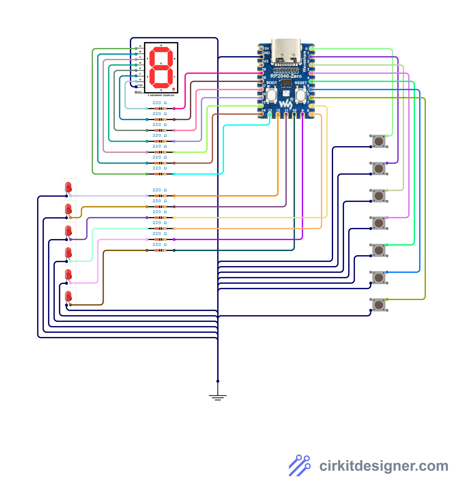
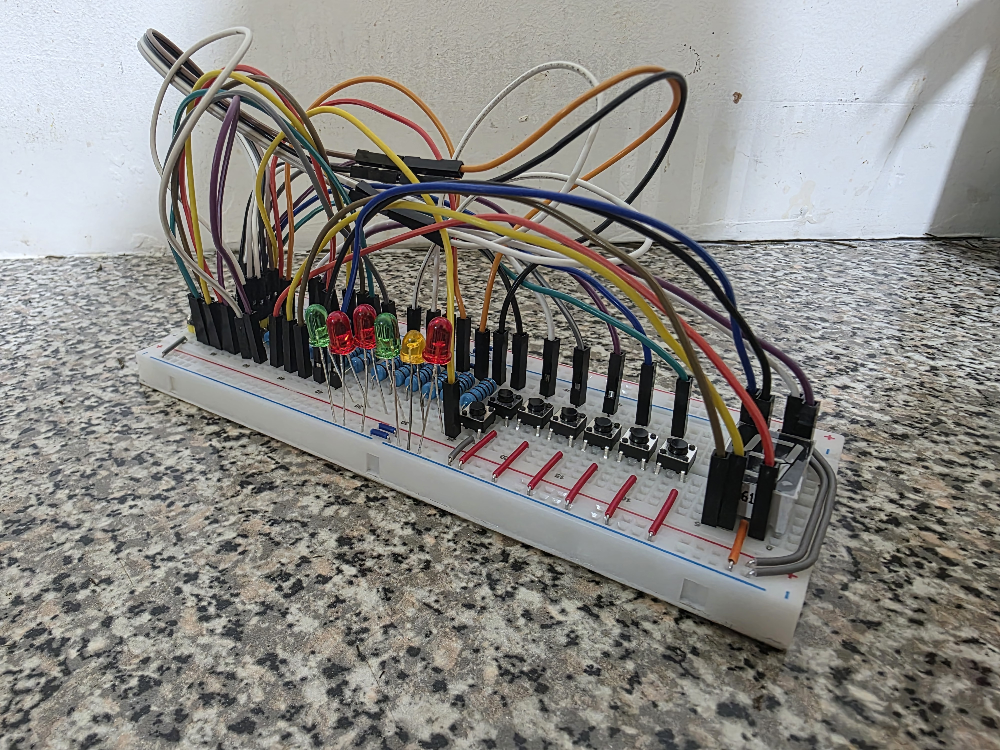
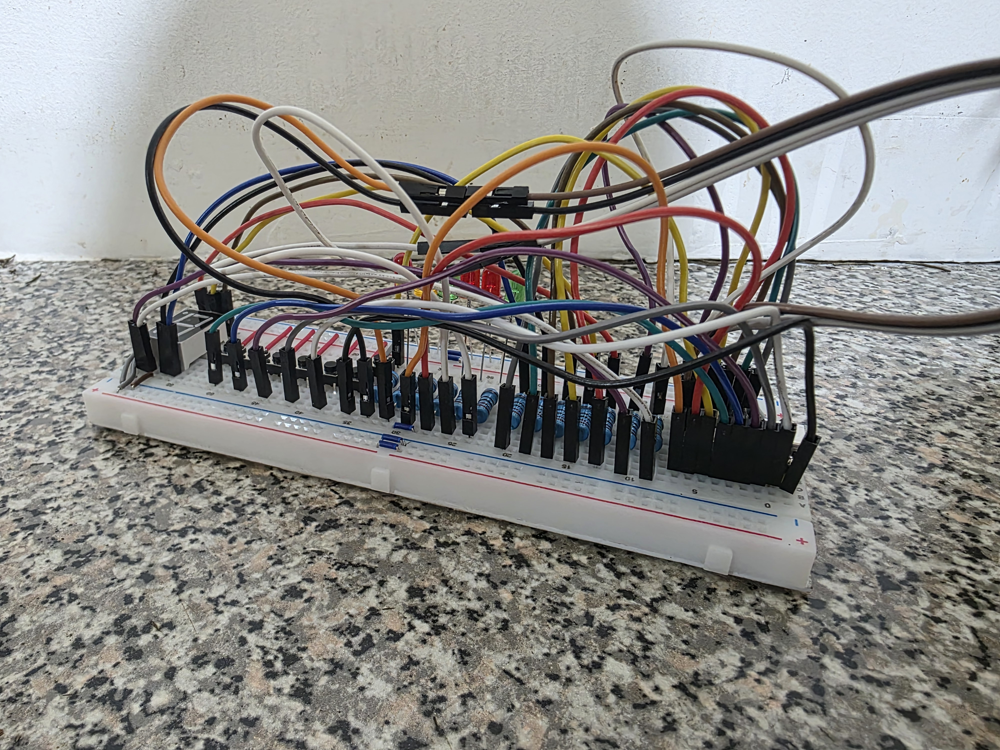

# Micro-CPU 2Bits
 
Modelo funcional y simplificado de una CPU con sistema de entrada/salida, construido sobre la placa **RP2040 Zero** y programado en **MicroPython**.
 
**Curso:** Arquitectura del Computador I · **Catedrático:** Josué Morataya
**Universidad:** Universidad Panamericana (UPANA), Guatemala
 
<!--
  INSERTAR IMAGEN (portada del proyecto): foto del proyecto terminado y funcionando.
  Archivo sugerido: MEDIA/Foto_Final_02.jpg
  Copiar esta línea justo debajo de este comentario:
  
-->
 
---
 
## Autores
 
| Nombre | ID |
|---|---|
| Angel Josue Ramirez Quiñonez | 000137770 |
| Edgar Illescas | 000099911 |
| Ximena de León | 000126356 |
 
---
 
## Objetivo
 
Simular, con hardware real, el funcionamiento básico de una CPU:
 
1. **Ciclo de instrucción** (Fetch, Decode, Execute, Write-Back) representado con una secuencia de LEDs.
2. **Banderas de estado** (Zero, Negative y Overflow) que se actualizan al realizar operaciones aritméticas.
3. **Calculadora de 2 bits**: suma y resta con operandos del **0 al 3**.
---
 
## Cómo funciona
 
### Ciclo de instrucción
 
Cada paso de la calculadora enciende el LED de la fase que se está simulando:
 
| LED | GPIO | Fase | Cuándo se enciende |
|---|---|---|---|
| FETCH | 7 | Fetch | Al leer cada operando (primero y segundo) |
| DECODE | 8 | Decode | Al leer la operación (`+` o `-`) |
| EXECUTE | 9 | Execute | Al presionar `=`; la ALU calcula y actualiza las banderas (2 s) |
| WRITE-BACK | 10 | Write-Back | Al mostrar el resultado en el display (2 s) |
 
### Banderas de estado
 
| Bandera | Indicador | GPIO | Se activa cuando |
|---|---|---|---|
| **Zero** | LED | 11 | El resultado es `0` |
| **Negative** | LED | 12 | El resultado es menor que `0` |
| **Overflow** | LED RGB integrado de la RP2040 Zero | 16 | El resultado queda fuera del rango `0-3` |
 
> **Nota de diseño:** como la calculadora trabaja con 2 bits sin signo (0-3), un resultado negativo (por ejemplo `1 - 2 = -1`) también está fuera de rango, por lo que activa **Negative** y **Overflow** a la vez. Cuando hay overflow, el display se apaga.
 
### Ejemplos de resultados
 
| Operación | Display | Zero | Negative | Overflow |
|---|---|---|---|---|
| `1 + 2 = 3` | 3 | apagado | apagado | apagado |
| `2 - 2 = 0` | 0 | **encendido** | apagado | apagado |
| `2 + 2 = 4` | apagado | apagado | apagado | **encendido** |
| `1 - 2 = -1` | apagado | apagado | **encendido** | **encendido** |
 
### Máquina de estados
 

 
---
 
## Hardware
 
- **Placa:** Waveshare RP2040 Zero (USB-C)
- **Entradas:** 7 pulsadores (dígitos `0`, `1`, `2`, `3` y operaciones `+`, `-`, `=`), con resistencia **Pull-Up interna** (presionado = 0)
- **Salidas:** 6 LEDs monocromáticos, 1 display de 7 segmentos de cátodo común y el LED RGB integrado
- **Detalle de pines:** [`DOCUMENTATION/PINOUT_FINAL.md`](Micro-CPU-2Bits/DOCUMENTATION/PINOUT_FINAL.md)
- **Lista de componentes:** [`DOCUMENTATION/COMPONENTES.md`](Micro-CPU-2Bits/DOCUMENTATION/COMPONENTES.md)
  
  
  
---
 
## Instrucciones de uso
 
### 1. Cargar el código en la RP2040 Zero (Thonny)
 
1. Instala [Thonny](https://thonny.org/) y el firmware de **MicroPython para RP2040** en la placa (mantén presionado el botón `BOOT`, conecta el cable USB-C y copia el archivo `.uf2` a la unidad que aparece).
2. En Thonny, abre **Herramientas → Opciones → Intérprete** y selecciona **MicroPython (Raspberry Pi Pico)** con el puerto de tu placa.
3. Abre `CODE/main.py`.
4. Guarda el archivo en la placa con **Archivo → Guardar como → Raspberry Pi Pico**, con el nombre `main.py`. Así se ejecuta automáticamente al conectar la placa.
5. Ejecuta con **F5** o reinicia la placa. En la consola de Thonny aparecerá `Micro-CPU 2Bits iniciada.`
### 2. Operar la calculadora
 
1. Presiona un **dígito** (`0`-`3`): se enciende **FETCH** y el dígito aparece en el display.
2. Presiona una **operación** (`+` o `-`): se enciende **DECODE**.
3. Presiona el **segundo dígito** (`0`-`3`): se enciende **FETCH** otra vez.
4. Presiona **`=`**: se enciende **EXECUTE** (se actualizan las banderas) y luego **WRITE-BACK** (se muestra el resultado).
5. Presiona **`=`** de nuevo para **reiniciar** y hacer un nuevo cálculo.
Durante Execute y Write-Back (unos 4 segundos) la calculadora no responde a los botones. Los pasos de cada operación también se imprimen en la consola de Thonny.
 
<!--
  INSERTAR VIDEO (opcional, recomendado): clip corto con una operación normal (1 + 2 = 3)
  y una operación con overflow (2 + 2 = 4).
  Archivo sugerido: MEDIA/Video_Funcionamiento.mp4
  Opciones: enlazarlo con [Ver video de funcionamiento](Micro-CPU-2Bits/MEDIA/Video_Funcionamiento.mp4)
  o subirlo a YouTube y pegar el enlace aquí.
-->
 
---
 
## Estructura del repositorio
 
```
Proyecto-Final-Micro-CPU-2bits/
├── README.md
└── Micro-CPU-2Bits/
    ├── CODE/
    │   └── main.py
    ├── DOCUMENTATION/
    │   ├── PINOUT_FINAL.md
    │   └── COMPONENTES.md
    ├── HARDWARE/
    │   └── Diagrama_Circuito.png
    └── MEDIA/
        ├── Foto_Ensamblaje_02.jpg
        ├── Foto_Ensamblaje_03.jpg
        └── Foto_Final_01.jpg
```
 
## Tecnologías
 
MicroPython · Thonny · Cirkit Designer · RP2040 Zero
